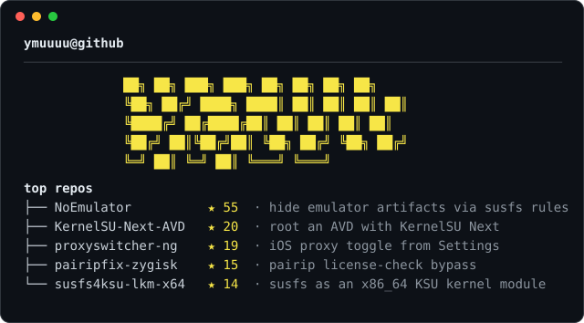
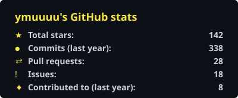
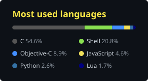

  

  
  

### 📝 latest from [n00b bl0g](https://ymuu.me)

<!-- BLOG-POST-LIST:START -->
- 📝 [Shadow Hooking: Hiding a Hook Inside the Kernel](https://ymuu.me/posts/shadow-hooking---hiding-a-hook-inside-the-kernel/)
- 📝 [DirtySepolicy: How Android&#39;s App Zygote Became a Root-Detection Oracle](https://ymuu.me/posts/dirtysepolicy---how-androids-app-zygote-became-a-root-detection-oracle/)
- 📝 [Bypassing MAUI Certificate SSL Pinning on Android](https://ymuu.me/posts/bypassing-maui-certificate-ssl-pinning-on-android/)

<!-- BLOG-POST-LIST:END -->

  <picture>
    <source media="(prefers-color-scheme: dark)" srcset="https://raw.githubusercontent.com/ymuuuu/ymuuuu/output/github-contribution-grid-snake-dark.svg">
    
  </picture>

  
  

